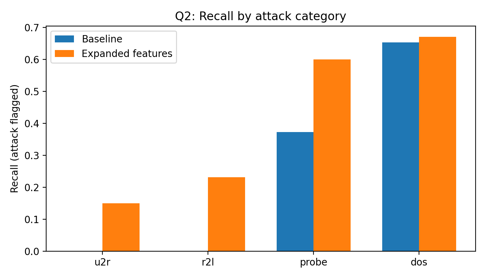

# AI for Cybersecurity

Three MC104 experiments connecting machine learning evaluation with practical
security questions.

[Research report](reports/exam_report.pdf) · [Notebooks](notebooks)

## Experiments

| Study | Dataset | Approach |
| --- | --- | --- |
| Normal traffic modelling | UNSW-NB15 | Regression on benign traffic and a residual-based suspicious-event rule |
| Intrusion classification | NSL-KDD | Logistic regression with baseline and expanded security feature sets |
| Malware image classification | Malimg | CNN trained from scratch, class-weighted loss and blur robustness evaluation |

The NSL-KDD analysis examines failures on minority attack categories.
The Malimg analysis shows why high classification accuracy can coexist with
sensitivity to a small change in image appearance.

## Results reported in the submitted study

The NSL-KDD classifier achieved about 66.3% baseline accuracy and 69.8% with the
expanded feature set. Baseline recall was particularly weak for U2R and R2L.

The baseline CNN achieved 97.9% test accuracy and 93.9% balanced accuracy.
After blur perturbation, its accuracy fell to 72.1%. The class-weighted model
achieved 97.8% test accuracy and 77.1% accuracy under blur.



These are results from the exam's benchmark splits and recorded runs.
They describe the experiments in the report.

## Setup and datasets

```bash
python3 -m venv .venv
.venv/bin/python -m pip install -r requirements.txt
.venv/bin/python -m jupyter notebook
```

Open the numbered notebooks from `notebooks/` so their relative paths resolve
against that directory. Obtain the benchmark data and organise it as follows.

```text
data/raw/unsw_nb15/UNSW_NB15_training-set.parquet
data/raw/unsw_nb15/UNSW_NB15_testing-set.parquet
data/raw/nsl_kdd/KDDTrain+.txt
data/raw/nsl_kdd/KDDTest+.txt
data/raw/malimg/train/<family>/*.png
data/raw/malimg/val/<family>/*.png
data/raw/malimg/test/<family>/*.png
```

The original exam used the supplied parquet files and explicit Malimg splits.
Matching these files and splits is required to compare against the recorded results.
Large datasets are acquired separately.

- [UNSW-NB15 source](https://research.unsw.edu.au/projects/unsw-nb15-dataset)
- [NSL-KDD source](https://www.unb.ca/cic/datasets/nsl.html)
- Malimg image data and the train/validation/test partition supplied with the course.

The report explains the feature choices, imbalance analysis, robustness test
and limitations. This is an academic security analysis with saved outputs.
